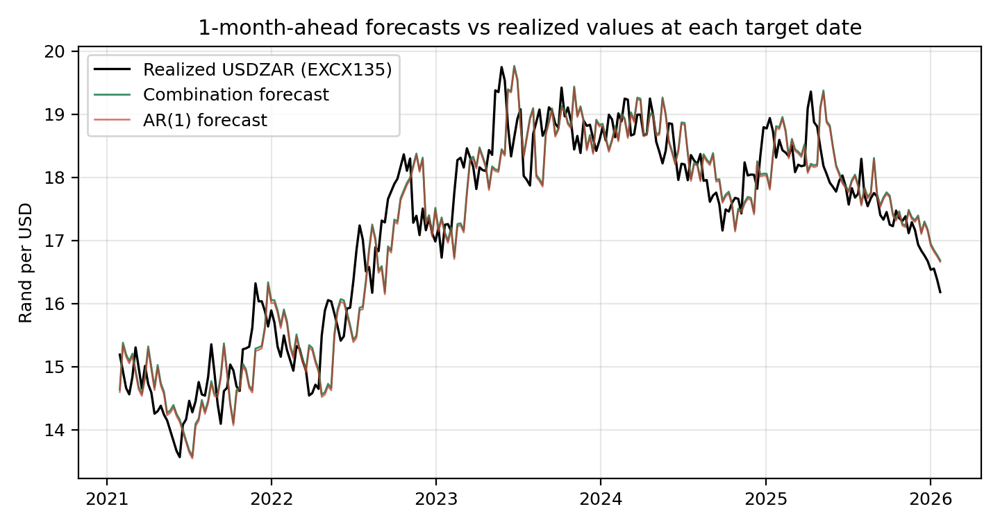

# Forecasting USDZAR one month ahead

261 out-of-sample forecasts of the rand, one every Friday from 1 January 2021 to
31 December 2025, at a 28-day horizon, scored against an AR(1) benchmark.

Built for the SES x Codera Analytics Hackathon in July 2026 and extended
afterwards. Throughout this repository "we" refers to the competition entry
(myself and Stefan von der Heyden) and "I" to the statistical work, test suite
and documentation added after it.

| | |
|---|---|
| Forecast combination (our model) | RMSE 0.5600 |
| AR(1) benchmark | RMSE 0.5624 |
| Improvement | 0.42 per cent, with 4 of 5 models ahead of the benchmark |
| Target series | SARB EXCX135, checked against the SARB Web API across 9 141 observations, maximum difference 0.000000 |
| Reproducibility | `data/processed` deleted and rebuilt from raw, maximum RMSE difference 2.22e-16 |

## Where to start

| | |
|---|---|
| Five minutes | The next two sections |
| Twenty minutes | [`notebooks/walkthrough.ipynb`](notebooks/walkthrough.ipynb), the analysis end to end with charts, already executed |
| An hour | [`docs/METHODOLOGY.md`](docs/METHODOLOGY.md), the full write-up |
| If you doubt the numbers | [`data/processed/forecast_log.csv`](data/processed/forecast_log.csv), all 261 forecasts, every model, recompute the headline in one line |
| If you doubt the discipline | `pytest -q`, fourteen tests that fail if any forecast could not have been made on the day it claims |

## The result

At a one-month horizon the rand is close to a random walk. Since Meese and Rogoff
(1983) structural exchange-rate models have lost to a no-change forecast with
some regularity, and honest published gains sit around 1 to 5 per cent in RMSE.
We did not try to fight that. The model is a combination: a random-walk anchor, a
carry tilt from the JIBAR minus US T-bill gap, and a heavily shrunk ridge on
commodity, dollar and risk factors, weighted by how accurate each one has been
recently.

It beats the AR(1) by 0.42 per cent. The more interesting part is that we can say
why.

## Why the benchmark loses

An AR(1) fitted to this series estimates persistence between 0.9971 and 0.9986.
Close to one, but below it, and anything below one pulls every forecast toward an
implied long-run mean of `c / (1 - phi)`. So the question is where that mean sat
relative to the market.

We refitted the AR(1) at all 261 origins and recomputed it each time. The implied
mean sat below the prevailing spot rate at every one of the 261 origins, by R2.11
on average and never by less than R0.57, while the rand was climbing from R14.62
to a peak of R19.74.

A mean-reverting model applied to a trending series pulls every forecast the wrong
way. RMSE squares errors, so the occasional large miss that produces does most of
the damage to the score.

That is the whole finding. Our models do not predict the rand better in any deep
sense. They decline to make one specific mistake, repeatedly. Which also tells you
when the advantage should disappear, and it does: 2025 goes to the benchmark,
because 2025 is the year the rand moved back toward the mean.



## What was added after the competition

The improvement is not statistically significant, with a Diebold-Mariano p-value
of 0.47. Left there, that is a weakness. The more useful question is what
significance would have taken.

| | |
|---|---|
| Origins available | 261 |
| Observed improvement | 0.42 per cent |
| Minimum detectable at 5 per cent with 80 per cent power | 1.64 per cent |
| Origins needed to detect an effect this size | 3 906, roughly 75 years of weekly forecasts |

A non-significant result on 261 origins is what you should expect at this effect
size, rather than evidence that the model does nothing. It also means a competing
entry reporting significance on a sub-1-per-cent improvement over the same window
is claiming something its data cannot support.

We also ran gradient boosting under identical rules as a control, expecting it to
lose, and it lost by 7.5 per cent. In the full pairwise DM matrix that is the only
difference anywhere that reaches significance. Keeping a failed model in the
results is more informative than dropping it.

The fourteen tests re-derive the leakage guarantees from the raw files rather than
trusting the pipeline that produced the processed ones. And section 12 of the
methodology lists four errors the audit caught, including a bug in my own
statistics module that understated a headline figure by twelve percentage points.

## The out-of-sample protocol

The part worth checking if you are evaluating this.

1. Information sets. Every predictor enters through a backward `merge_asof`, so a
   forecast made on Friday `t` sees only observations dated on or before `t`.
2. No publication lags. Every predictor is a daily market price or rate, never
   revised and never delayed, which makes look-ahead bias impossible by
   construction rather than merely avoided. We gave up CPI and the current account
   to buy that.
3. Resolved-only training. The regressions train only on origins whose 28-day
   outcome had already resolved: `tr = tr[tr.index <= i - H]`.
4. Embargoed weights. Combination weights use only errors from forecasts resolved
   28 days before the current origin.
5. Frozen configuration. Feature set, intercept choice, decay and sharpness were
   chosen on a 2015-2020 validation era whose targets all resolve before 2021,
   then frozen. The whole search grid is committed in
   [`validation_metrics.json`](data/processed/validation_metrics.json), so you can
   see how many configurations were tried and not only which one won.

## Models

| Model | RMSE | vs AR(1) | What it is |
|---|---|---|---|
| AR(1) | 0.5624 | — | The required benchmark. OLS with intercept on the weekly log level, expanding window from 1999, iterated 4 steps. Scored against the better of the log and level variants. |
| Random walk | 0.5600 | +0.43% | No change. The strongest single benchmark at this horizon. |
| Combination | 0.5600 | +0.42% | Our submission. Inverse discounted-MSE weighted average of {RW, carry, ridge}, decay 0.97, sharpness 2. |
| Ridge | 0.5605 | +0.34% | 4-week log return on the compact predictor set. Standardised in-window, penalty by time-ordered CV, no intercept, so heavy shrinkage collapses it into the random walk instead of a stale mean. |
| Carry | 0.5606 | +0.31% | Covered-interest-parity forward rate from the JIBAR minus US T-bill gap. |
| Gradient boosting | 0.6046 | −7.51% | Depth-2 comparator under identical discipline, kept as a control. |

## Repository layout

```
├── README.md
├── notebooks/
│   └── walkthrough.ipynb          the analysis end to end, executed
├── docs/
│   ├── METHODOLOGY.md             the full write-up
│   └── original_task_brief.pdf    the competition brief
├── src/
│   ├── fetch_data.py              1. download every raw series
│   ├── verify_provenance.py       2. EconData against the SARB Web API
│   ├── build_dataset.py           3. weekly Friday dataset, backward as-of merges
│   ├── run_backtest.py            4. walk-forward out-of-sample backtest
│   ├── statistical_tests.py       5. DM matrix, power analysis, rolling accuracy
│   ├── make_figures.py            6. report figures
│   ├── make_presentation_figures.py
│   ├── validate_results.py        8. audit every plotted number against raw data
│   ├── make_report.py             9. build the technical report PDF
│   ├── build_notebook.py          regenerate the walkthrough notebook
│   ├── make_presentation.js       rebuild the slide deck (Node)
│   └── run_all.py                 the whole pipeline in order
├── tests/
│   └── test_no_lookahead.py       fourteen leakage and integrity tests
├── data/
│   ├── raw/                       exactly as downloaded, never hand-edited
│   └── processed/                 weekly.csv, forecast_log.csv, metrics.json,
│                                  statistical_tests.json, validation_metrics.json
├── figures/
└── reports/
    ├── technical_report.pdf
    └── presentation.pptx
```

## Reproducing everything

```bash
git clone <this-repo> && cd <this-repo>
pip install -r requirements.txt

python src/run_all.py     # data, backtest, statistics, figures, report (~5 min)
pytest -q
```

No API keys and no paid data. The raw files are committed, so everything from
`build_dataset.py` onwards runs offline. Rerunning reproduces every published
number to twelve decimal places.

Rebuilding the slide deck also needs Node: `cd src && npm install && node make_presentation.js`.

## Data

| Series | Source | Role |
|---|---|---|
| USDZAR (EXCX135) | SARB via EconData, `MARKET_RATES 1.0.0`, `EXCX135.B.A` | Target |
| JIBAR 3M | SARB Web API | Carry |
| US 3M Treasury bill | FRED (`DTB3`) | Carry |
| Gold, platinum, Brent | SARB, NYMEX, FRED | Commodity block |
| Broad US dollar index, VIX | FRED (`DTWEXBGS`, `VIXCLS`) | Dollar strength, global risk |

SARB. *MARKET_RATES*. Version 1.0.0. Pretoria: SARB [producer]. Johannesburg:
EconData [distributor], 2026.

## What is not claimed

Statistical significance, for the reasons above. Directional predictability, which
sits near 50 per cent for every model, so nothing here calls which way the rand
moves. Profitability, which was never tested, and which is a different objective
from RMSE. Persistence of the advantage, since 2025 already goes the other way.

The direction I would take next is option-implied volatility and risk reversals,
following Greenwood-Nimmo, Steenkamp and van Jaarsveld (SARB WP/22/14), and then
density rather than point forecasts. For anyone actually hedging currency risk the
distribution is the decision-relevant object, and forecasting dispersion in a
series whose mean is nearly unforecastable is the better-posed problem.

## Author

Aakash Anil, BCom Honours Economics, Stellenbosch University, with Stefan von der
Heyden, entered as team *Spurious Decision*. The entry did not place. I rebuilt
the repository afterwards as a portfolio piece and added the statistical testing,
power analysis, tests and documentation at that point.

Anthropic's Claude was used as a coding and research assistant for pipeline code,
literature search and typesetting. The modelling decisions, validation design and
final specification are mine. OLS, ridge and weighted averages were chosen partly
so that every component can be derived by hand.

MIT licensed. See [LICENSE](LICENSE) for the data terms, which differ.
